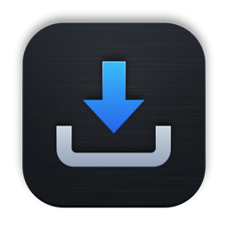

<p align="center">
  
</p>

<h1 align="center">DropShelf</h1>

<p align="center">A floating shelf for macOS to temporarily park files, images, text and links.</p>

DropShelf is a small macOS menu bar app. Drop things onto a floating shelf, then drag them out again somewhere else or send them off.

## Features

- **Floating shelf** with a glass look, visible on all Spaces, freely movable
- **Drag in and out** of files, images, text and URLs, singly or as a stack (hold Option to copy)
- **Send** via AirDrop, Messages, Mail and Share…
- **Actions**: Quick Look (Space), compress as ZIP, reveal in Finder, copy paths
- **Convert** files from the context menu: text, images, audio, video, PDF and fonts, with optional replace-in-shelf
- **Edit** from the context menu: merge PDFs and images into one PDF, compress PDFs, reorder, rotate, delete and extract PDF pages, trim audio and video
- **Rename** a file by clicking its name on the shelf
- **History** of previous shelves
- **Shake to open**: shake the mouse while dragging a file and a shelf opens at the pointer
- **Settings**: auto-close, "Clear shelf?" prompt after AirDrop, glass intensity, animations (respects "Reduce motion"), launch at login

## Keyboard shortcuts

| Action | Default |
|---|---|
| New shelf at the mouse | ⌃⌥Space |
| Send the active shelf via AirDrop | ⌃⌥A |
| Open history | ⌃⌥V |

Shortcuts can be re-recorded under Settings › Shortcuts (they need at least ⌃, ⌥ or ⌘) or turned off.

## Requirements

- macOS 14 or later
- To build from source: Xcode (Swift 6) and [XcodeGen](https://github.com/yonaskolb/XcodeGen)

## Privacy & security

- The clipboard history is on by default. It is stored locally in the app's sandbox container, at `~/Library/Containers/com.horn2208.DropShelf/Data/Library/Application Support/DropShelf/clipboard/`.
- Unpinned text expires after 24 hours.
- Entries that password managers mark as concealed or transient are skipped, and copies from the Passwords app and Keychain Access are always ignored. Passwords copied from sources that don't mark them, such as notes or some browser extensions, may still be recorded. Use "Pause 5 minutes" in Settings in that case.
- The history is excluded from backups and can be cleared in Settings.
- The Accessibility permission is optional. It is only needed for pasting directly into the previous app when you pick a history entry, and for shake-to-open. Without it, picking an entry just copies it.
- The app makes one kind of network request: it checks the GitHub releases page for a newer version, at most once a day at launch. You can turn this off in Settings › General ("Automatisch nach Updates suchen"), or check manually. A new DMG is only downloaded when you click the download button.
- The DMG is ad-hoc signed and not notarized. Build from source if you prefer.

## Install

Download the DMG from the [Releases](https://github.com/Horn2208/DropShelf/releases) page and drag DropShelf to `/Applications`. The app is not notarized, so on first launch right-click it and choose Open, or allow it under System Settings › Privacy & Security.

## Updates

On launch (at most once a day) and on demand, DropShelf checks GitHub for a newer release and offers to open the release page or download the DMG into your Downloads folder. The automatic check can be turned off in Settings.

## Build from source

```sh
xcodegen
xcodebuild -project DropShelf.xcodeproj -scheme DropShelf -configuration Release -derivedDataPath build build
```

The app ends up in `build/Build/Products/Release/DropShelf.app`. For launch at login to work reliably, copy it to `/Applications`. The icon can be regenerated with `swift scripts/make-icon.swift`.

The "Troll" build variants use a bundled sound and image that are not included in this repository, so those targets do not build from a clone.

## Permissions

- **Accessibility**: only for shake detection (it reads mouse movement only). Everything else works without it.
- Keyboard shortcuts need no permission.

## Sandbox

DropShelf runs in the App Sandbox. File access goes through files the user dropped and security-scoped bookmarks, so shelves survive a restart. The only network access is the update check against GitHub. Audio and image conversion use statically linked open-source codec libraries (Ogg/Vorbis, Opus, FLAC, LAME, WebP, WavPack); see [THIRD-PARTY-LICENSES.md](THIRD-PARTY-LICENSES.md).

## License

Source-available under the [PolyForm Noncommercial License 1.0.0](LICENSE). Free for personal and other noncommercial use. Commercial use is not permitted.

© 2026 Lennet Schierhorn (Horn2208)
